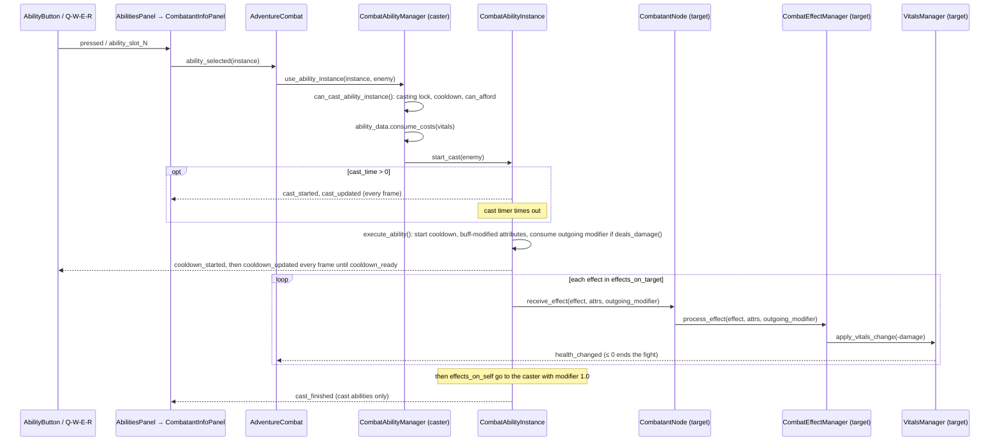

# Combat Architecture

Last updated: 2026-10-18

Short orientation for the code in `scenes/combat/`. The maintained reference (data model, damage formula, buffs, AI, UI, enemy content, open work) is [docs/combat/COMBAT.md](../../docs/combat/COMBAT.md).

> Earlier versions of this file described a `CombatantResourceManager`, a `CombatView` script, `CombatEncounter` and `character_abilities_data`. None of those exist: the resource manager became `VitalsManager` (2025-11-29), the fight is hosted by `AdventureView`, encounters use `CombatChoice`, and the loadout comes from `AbilityManager`.

## What lives here

| Path | Contents |
|------|----------|
| `adventure_combat/` | `AdventureCombat` (Node2D): builds both combatants per fight, attaches the enemy AI, watches both Health values, computes gold, emits `trigger_combat_end(is_successful, gold_earned)` |
| `combatant/` | `CombatantNode` and its components: `CombatAbilityManager` + `CombatAbilityInstance`, `VitalsManager`, `CombatEffectManager`, `CombatBuffManager` + `ActiveBuff` |
| `ai/` | `SimpleEnemyAI`: longest-cooldown ready ability first; self-heals only when they would not overheal |

Combat UI is in `scenes/ui/combat/` (`CombatantInfoPanel`, `AbilitiesPanel`, `AbilityButton`, `BuffIcon`, ability and buff tooltips). Data classes are in `scripts/resource_definitions/combat/` and `scripts/resource_definitions/abilities/`.

## Runtime composition

```
AdventureView                                   scenes/adventure/adventure_view/
├── CombatView/…/SubViewport
│   └── AdventureCombat (Node2D)
│       ├── Atmosphere                          added in _ready()
│       ├── CanvasLayer/EnemyInfoPanel          CombatantInfoPanel
│       ├── PlayerCombatant (CombatantNode)     vitals = PlayerManager.vitals_manager (persistent)
│       └── EnemyCombatant (CombatantNode)      own VitalsManager, full vitals each fight
│           └── EnemyAI (SimpleEnemyAI)
└── PlayerInfoPanel                             CombatantInfoPanel, persistent across fights

CombatantNode
├── CombatAbilityManager → AbilityInstance_<name> × N (cooldown + cast Timers)
├── VitalsManager
├── CombatEffectManager
└── CombatBuffManager (1 s DoT Timer)
```

There are no sprites; the two info panels are the on-screen representation of the combatants.

## How a fight runs

1. `AdventureTilemap.start_combat(choice)` → `AdventureView._on_start_combat()` → `AdventureCombat.initialize_combat(choice, action_data)` and `start()`.
2. The player combatant gets `CharacterManager.get_total_attributes_data()` and `AbilityManager.get_equipped_abilities()`; the enemy is `choice.enemy_pool[0]`. Each ability becomes a `CombatAbilityInstance` with a 1.5 s opening cooldown (skipped when `base_cooldown` is 0).
3. Player input (`AbilitiesPanel` click or Q/W/E/R) and the AI both call `CombatAbilityManager.use_ability_instance(instance, target)`.
4. The receiving combatant resolves each effect in its own `CombatEffectManager`; `DAMAGE` and `HEAL` change its `VitalsManager`, `BUFF` goes to its `CombatBuffManager`, `CANCEL_CAST` and `STRIP_BUFFS` hit its ability and buff managers.
5. Health ≤ 0 on either side → `trigger_combat_end` → `AdventureView._on_stop_combat()` → `AdventureCombat.stop()` (clear buffs, free combatants) → `AdventureTilemap.handle_combat_result()`.

## Ability call flow



The enemy path is the same except `SimpleEnemyAI` calls `use_ability_instance()` directly.
